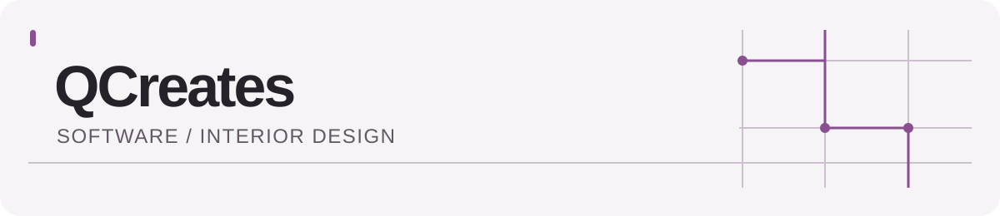

<picture>
  <source media="(prefers-color-scheme: dark)" srcset="./assets/qcreates-header-dark.svg">
  <source media="(prefers-color-scheme: light)" srcset="./assets/qcreates-header-light.svg">
  
</picture>

# Qasem Abdeljaber

I build practical software around the work I know: product data, retail workflows, and useful interfaces. I also offer interior design consultations through QCreates.

**Explore:** [Design consultation site](https://q-creates.com/) · [Public repositories](https://github.com/QCreates?tab=repositories)

## Selected work

### [QCreates site](https://github.com/QCreates/qcreates.github.io)

The live site for my interior design consultation work, built with HTML, CSS, and JavaScript. [Visit the site →](https://q-creates.com/)

### [Athan](https://github.com/QCreates/athan)

A Python project that reads prayer times from the EPIC Masjid site, schedules local audio, and serves a small Flask dashboard.

### [RoasterApp](https://github.com/QCreates/RoasterApp)

A Flutter prototype for coffee roaster records. Bean types can be added, edited, and stored locally; the other sections are still placeholders.

### [ImageOrganizer](https://github.com/QCreates/ImageOrganizer)

A focused Python utility that turns extra image columns in a product spreadsheet into image rows for a Shopify-oriented workflow.

## What is in these repositories

Python · Dart / Flutter · HTML / CSS / JavaScript · Django · C#

I favor tools with a clear job and interfaces that explain themselves. The repositories above show the work as it stands, including prototypes still in progress.
